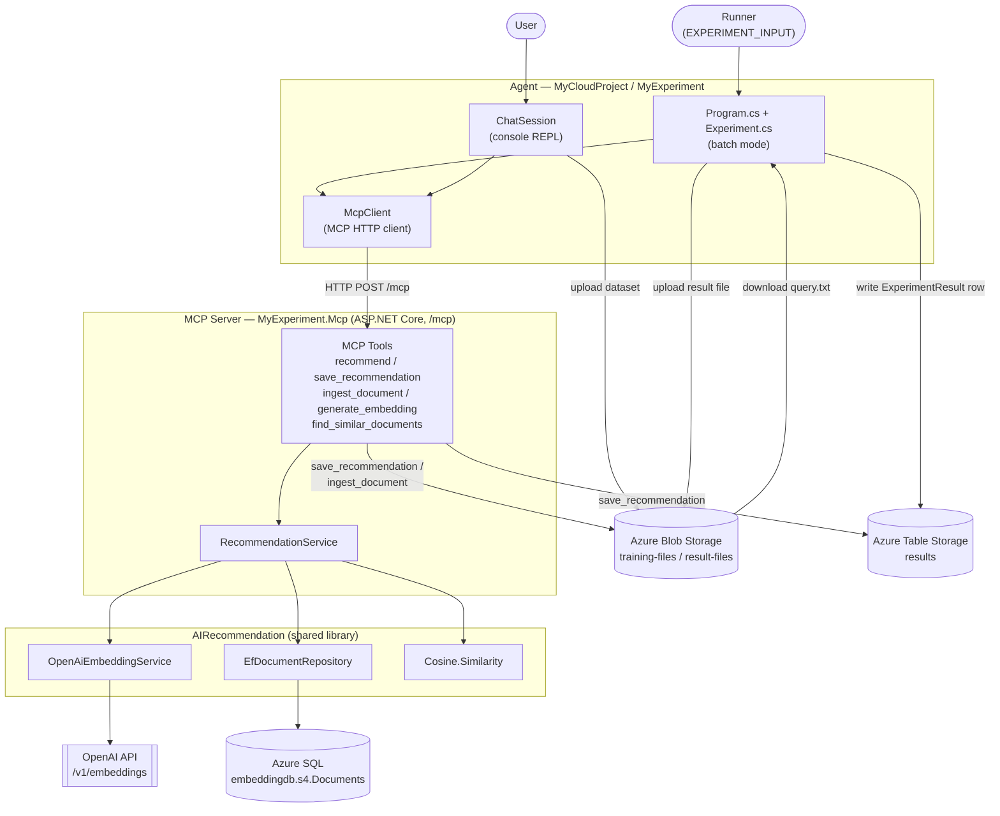
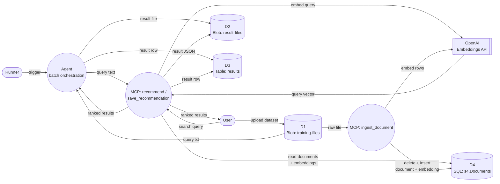
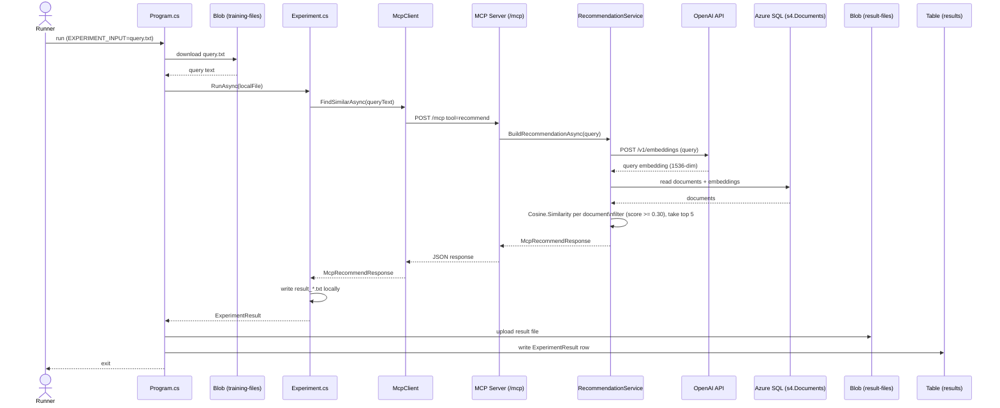
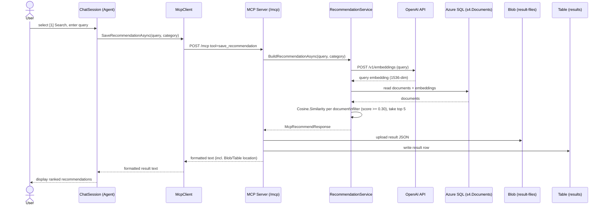
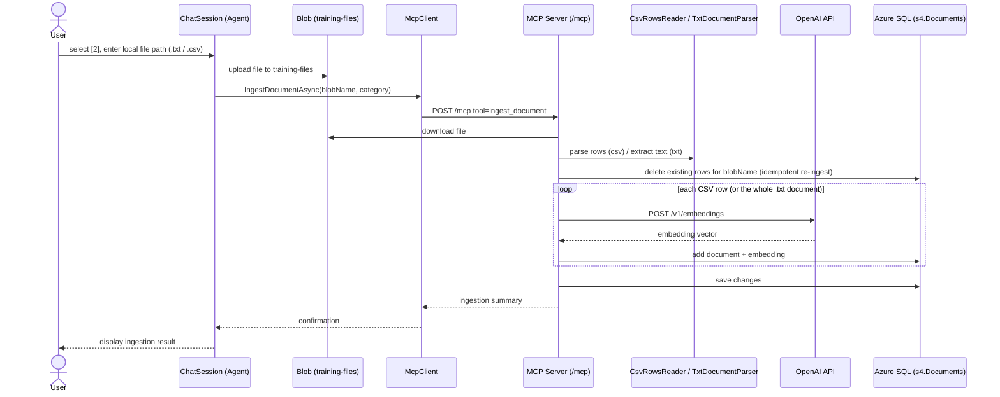

# AI Recommendation Agent — Architecture

## 1. System Architecture

**Notes**
- The Agent never calls OpenAI or Azure SQL directly — it only calls the MCP server over HTTP.
- The MCP server is the only component with access to OpenAI and Azure SQL.
- Two independent paths write results: batch mode persists from the **Agent** (`Program.cs`/`Experiment.cs`,
  via `IStorageProvider`); chat search persists from the **MCP server** (`save_recommendation` tool). The
  `recommend` tool used by batch mode does not persist anything itself.
- `AIRecommendation` is a shared class library, not a separate deployable service.
- Deployment: MCP server runs as an Azure Container App; images built to Azure Container Registry.

---

## 2. Data Flow Diagram

---

## 3. End-to-End Sequence — Batch Mode

---

## 4. End-to-End Sequence — Chat: Search / Recommend

---

## 5. End-to-End Sequence — Chat: Upload / Ingest Dataset

