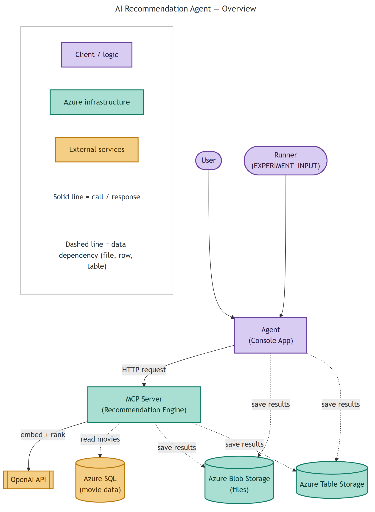
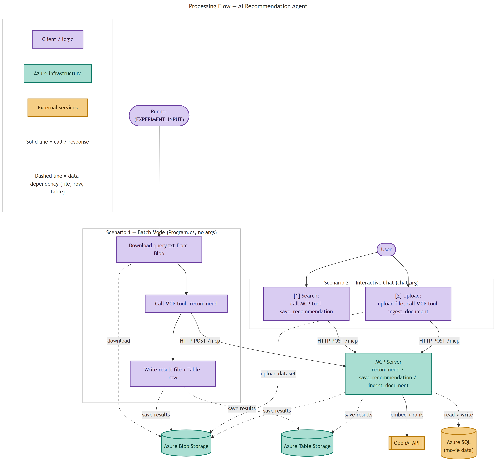

# AI Recommendation Agent Plugin — Azure Cloud

The project recommends documents using OpenAI text embeddings and cosine similarity. The recommendation logic runs on Microsoft Azure through an MCP server hosted on Azure App Service. In batch mode the agent automatically downloads a query file from Azure Blob Storage, calls the MCP server, and saves the ranked results back to Blob Storage and Azure Table Storage. In chat mode a natural-language console agent lets a user search for recommendations or ingest new datasets simply by typing requests. The Agent writes the result to Azure Blob
Storage and Azure Table Storage.
The recommendation engine (embeddings, parsing, persistence, similarity) was developed in our Software
Engineering project and is reused here unchanged, wrapped as MCP tools.

- **Project number:** ML25-26-03
- **Team Name:** Team_Insight_agent
- **Deployed MCP server:** `https://insightagent-mcp-server.livelydesert-d51e2e96.germanywestcentral.azurecontainerapps.io`

## Table of Contents

- [Overview](#overview)
- [Architecture](#architecture)
- [Solution Structure](#solution-structure)
- [Projects](#projects)
- [Getting Started](#getting-started)
- [Configuration](#configuration)
- [Usage](#usage)
- [Deployment](#deployment)
- [Known Issues Found & Fixed](#known-issues-found--fixed)
- [Project Information](#project-information)

## Overview

This solution implements a cloud-native recommendation experiment that:

- Is triggered with a query (via the `EXPERIMENT_INPUT` environment variable, or a local `query.txt`
  fallback) rather than by polling an Azure Storage Queue — there is no queue in the current architecture.
- Downloads the query file from Azure Blob Storage.
- Sends the raw query text to an MCP backend service, which embeds it, computes cosine similarity against
  the stored movie embeddings in Azure SQL, and returns the top-ranked matches. The Agent never talks to
  OpenAI or Azure SQL directly — only the MCP server does.
- Uploads the result file to Azure Blob Storage and writes a result row to Azure Table Storage.

## Architecture



The Agent (`MyCloudProject` + `MyExperiment`) never calls OpenAI or Azure SQL directly — it only calls the
MCP server (`MyExperiment.Mcp`) over HTTP. The MCP server is the only component with access to the OpenAI
embeddings API and Azure SQL. Both the Agent (batch mode) and the MCP server (chat search / ingest) can
persist results to Blob Storage and Table Storage.

See [`Documentation/architecture.png`](Documentation/architecture.png) and
[`Documentation/Marmaid architecture with
sequence diagram.md`](Documentation/Marmaid%20architecture%20with%20sequence%20diagram.md) for the full
component-level diagram (all five MCP tools, the shared `AIRecommendation` library, every read/write edge,
a data flow diagram, and end-to-end sequence diagrams for batch mode plus both chat scenarios).

### Processing Flow



`MyCloudProject` has two entry points that share the same downstream Azure data layer (SQL, Blob, Table):

- **Scenario 1 — Batch mode** (no CLI args, used by the graded cloud process): downloads `query.txt` from
  Blob, calls the MCP `recommend` tool, writes and uploads the result file, then writes an
  `ExperimentResult` row to Table Storage.
- **Scenario 2 — Interactive chat** (`chat` arg): a console REPL where `[1] Search` calls the MCP
  `save_recommendation` tool (embed → rank by cosine similarity → save to Blob + Table → display), and
  `[2] Upload a new dataset` uploads a local file to the `training-files` Blob container for later
  ingestion.

## Solution Structure

```
Cloud_Project_AIRecommendationAgentPlugIn/
├── MyCloudProject/            # Agent — console entry point / orchestrator
├── MyCloudProject.Common/     # Shared contracts: IExperiment, IExperimentResult, IStorageProvider
├── MyExperiment/              # Agent's experiment implementation + Azure integration
├── MyExperiment.Mcp/          # MCP server — the recommendation engine, exposed as MCP tools
├── AIRecommendation/          # Recommendation engine class library (embeddings, EF Core, similarity)
└── UnitTests/                 # xUnit tests for AIRecommendation's core logic + ChatSession routing
```

> Despite the `MyCloudProject.sln` project names above, do not confuse this with an earlier, aspirational
> naming scheme (`AIRecommendation.Cloud`, `.Common`, `.Infrastructure`, `.Mcp`) that appeared in older
> drafts of this document — those projects were renamed and this README now matches the actual solution.

## Projects

### 1. MyCloudProject (Agent / console application)

**Purpose**: Entry point and orchestration. Runs in one of two modes:

- **Batch mode** (default, used by the graded cloud process): reads `EXPERIMENT_INPUT` (fallback
  `query.txt`), downloads it from Blob, runs one recommendation, uploads the result, exits.
- **Interactive chat mode** (`dotnet run --project MyCloudProject -- chat`): an interactive console loop
  that talks only to the existing MCP server and its existing tools — no new Azure resources involved. Each
  turn asks: `[1]` search for a recommendation, or `[2]` upload a new dataset.
  - `[1] Search` — prompts for a natural-language query, calls the MCP `save_recommendation` tool: the
    result is shown on screen **and** saved to Blob (JSON) + Table Storage.
  - `[2] Upload a new dataset` — prompts for a local `.txt`/`.csv` file path (+ optional category), uploads
    it as-is to the `training-files` Blob container, then calls the MCP `ingest_document` tool, which
    embeds it and stores it in Azure SQL. A `.csv` is split one row = one document (e.g. a 100-row dataset
    becomes 100 separately-searchable documents); a `.txt` becomes a single document.
  - Advanced commands (not required for normal use): `/preview <query>` and `/similar <query>` run
    `recommend` / `find_similar_documents` without saving; `/embed <text>` calls `generate_embedding`.
    `/help` lists commands; `exit` / `quit` / `bye` (with or without a leading `/`) ends the session.

**Key files**:
- `Program.cs` — picks batch vs. chat mode from the `chat` command-line arg; batch mode downloads the input
  from Blob, runs the experiment, uploads the result.
- `ChatSession.cs` — the interactive REPL: command parsing and MCP tool calls (via `McpClient`).
- `appsettings.json` / `appsettings.dev.json` — configuration.
- `Dockerfile` — container definition.

### 2. MyCloudProject.Common (class library)

**Purpose**: Shared contracts used by both the Agent and the MCP server.

**Key files**: `IExperiment.cs`, `IExperimentResult.cs`, `IStorageProvider.cs`, `McpContracts.cs`
(`McpRecommendRequest`/`McpRecommendResponse`), `InitHelpers.cs` (config + logging bootstrap).

### 3. MyExperiment (Agent implementation)

**Purpose**: The Agent's experiment logic and Azure integration.

**Key files**:
- `Experiment.cs` — implements `IExperiment.RunAsync`: resolves the query, calls the MCP server via
  `McpClient`, writes the result file, builds an `ExperimentResult`.
- `McpClient.cs` — MCP client; calls the `recommend` tool at `{McpServerUrl}/mcp`.
- `AzureStorageProvider.cs`, `AzureBlobStorageProvider.cs`, `AzureTableStorage.cs`,
  `AzureQueueHandler.cs` — Blob download/upload and Table row write. `AzureQueueHandler` now reads
  `EXPERIMENT_INPUT` instead of polling a real Azure Queue.
- `MyConfig.cs` — bound from the `MyConfig` appsettings section.

### 4. MyExperiment.Mcp (MCP server)

**Purpose**: The recommendation engine, exposed as MCP tools over a stateless HTTP transport at `/mcp`.

**Key files**:
- `Program.cs` — MCP server host; registers five tools and binds `McpConfig` + `OpenAI` config sections.
- `McpRecommendationTool.cs` — `RecommendationTools.Recommend` (tool name `recommend`), the tool the Agent
  calls. Embeds the query, ranks documents, returns the full `McpRecommendResponse` as JSON.
- `SaveRecommendationTool.cs` — `SaveRecommendationTools.SaveRecommendation` (tool name
  `save_recommendation`). Runs the same ranking process and additionally persists the result as a JSON
  blob **and** a summary row in Table Storage — useful for saving a result directly from an MCP client
  without going through the Agent.
- `IngestDocumentTool.cs` — `IngestDocumentTools.IngestDocument` (tool name `ingest_document`). Downloads a
  dataset blob already uploaded to `training-files`, embeds it, and stores it in Azure SQL. A `.csv` is
  split one row = one document (via `CsvRowsReader`); a `.txt` becomes a single document. **Idempotent**:
  re-ingesting the same blob name first deletes its previous rows (`IDocumentRepository.DeleteByFileNameAsync`),
  so a re-upload replaces rather than duplicates — see [Known Issues](#known-issues-found--fixed) below.
- `EmbeddingTool.cs`, `CosineSimilarityTool.cs` — `generate_embedding` and `find_similar_documents`,
  lower-level/debug tools.
- `Recommendationservice.cs` — shared ranking logic used by all five tools; wires `OpenAiEmbeddingService`
  and `EfDocumentRepository`.

### 5. AIRecommendation (class library)

**Purpose**: The recommendation engine — parsing, embeddings, persistence, similarity — developed in a
separate SE project and reused here.

**Layout**: `Application/{Interfaces,Services,Tools,Configuration}`, `Domain/Entities`,
`Infrastructure/{Embeddings,Parsing,Persistence,Similarity}`. `AppDbContext`/`EfDocumentRepository` are the
EF Core access layer (Azure SQL at runtime, SQLite for design-time migrations via `AppDbContextFactory`).
`IDocumentRepository.DeleteByFileNameAsync` (added for the `ingest_document` MCP tool) deletes all rows for
a given source file name, used to make re-ingestion idempotent. `CsvRowsReader` parses a `.csv` into one
`Dictionary<string,string>` per row, keyed by header — used to split a multi-row dataset into separate
documents.

## Getting Started

### Prerequisites

- .NET 9 SDK
- Azure Storage Account (or Azurite for local development)
- Azure SQL Database holding the embedded document store
- An OpenAI API key (the MCP server needs this to embed queries)
- Docker Desktop (for building/running the container images)

### Installation

```bash
dotnet restore
dotnet build MyCloudProject.sln
```

```bash
dotnet test UnitTests/UnitTests.csproj
```

`UnitTests` covers the deterministic, dependency-free logic in `AIRecommendation` — `Cosine.Similarity`,
`CsvRowsReader`, `IdBlockChunker`, `TxtDocumentParser`, `RecommendationFormatter` — plus `ChatSession`'s
chat-mode routing predicates (`IsSearchChoice`, `IsUploadChoice`, `IsExitCommand`) in `MyCloudProject`,
exercised via reflection since they're `private static`. Anything that needs Azure SQL, Blob Storage, or
the OpenAI API (the EF repository, the storage providers, the MCP tools themselves) is exercised instead by
the live end-to-end runs documented under [Known Issues Found & Fixed](#known-issues-found--fixed).

## Configuration

Config resolution (`InitHelpers.InitConfiguration`): loads `appsettings.json` by default, or
`appsettings.{MYCLOUDPROJECT_ENVIRONMENT}.json` when that env var is set (e.g. `dev` →
`appsettings.dev.json`), then command-line args, then environment variables (highest precedence).

### MyCloudProject — `MyConfig` section

| Property | Description |
|---|---|
| `GroupId` | Group/experiment identifier — used as the Table Storage `PartitionKey` |
| `StorageConnectionString` | Azure Storage connection string (`UseDevelopmentStorage=true;` for Azurite) |
| `TrainingContainer` | Blob container the query input file is downloaded from |
| `ResultContainer` | Blob container result files are uploaded to |
| `ResultTable` | Table Storage table the `ExperimentResult` row is written to |
| `McpServerUrl` | Base URL of the MCP server the Agent calls |
| `TopN` | Number of top recommendations requested (default 5) |

### MyExperiment.Mcp — `McpConfig` and `OpenAI` sections

| Property | Description |
|---|---|
| `McpConfig.SqlConnectionString` | Azure SQL connection string (the document/embedding store) |
| `McpConfig.StorageConnectionString` | Used by `save_recommendation` to write Blob + Table results |
| `McpConfig.ResultContainer` / `ResultTable` | Defaults: `result-files` / `results` — same as the Agent's |
| `McpConfig.TrainingContainer` | Blob container `ingest_document` reads uploaded datasets from (default `training-files` — reuses the Agent's existing input container, no new container) |
| `McpConfig.MinScoreThreshold` | Minimum cosine score for a result to be included (default 0.30) |
| `OpenAI.ApiKey` / `OpenAI.Model` | Embedding credentials/model (default `text-embedding-3-small`) |

### Key environment variables

| Variable | Applies to | Description |
|---|---|---|
| `MYCLOUDPROJECT_ENVIRONMENT` | Both | `dev` loads `appsettings.dev.json` |
| `EXPERIMENT_INPUT` | Agent | Blob name of the query file to download (fallback: `query.txt`) |
| `MyConfig__StorageConnectionString` | Agent | Overrides the storage connection string |
| `MyConfig__McpServerUrl` | Agent | Overrides the MCP server URL |
| `OpenAI__ApiKey` | MCP server | The OpenAI key used to embed queries — never commit a real value |
| `PORT` / `ASPNETCORE_URLS` | MCP server | Overrides the listen port (default `5080`) |

## Usage

```bash
# 1. Start the MCP server (listens on :5080 by default)
dotnet run --project MyExperiment.Mcp

# 2. In another terminal, run the Agent (needs EXPERIMENT_INPUT env var or a local query.txt)
dotnet run --project MyCloudProject
```

The Agent downloads the query named by `EXPERIMENT_INPUT` from the `TrainingContainer` blob container,
calls the MCP server's `recommend` tool, writes the formatted result to a local file, uploads it to the
`ResultContainer`, and writes a result row to `ResultTable`.

For interactive use instead of a single batch run:

```bash
dotnet run --project MyCloudProject -- chat
```

```
What would you like to do?
  [1] Search for a movie recommendation
  [2] Upload a new dataset
  (or type 'exit' to quit, '/help' for advanced commands)
you> 1
Enter your recommendation query> feel-good sci-fi from the 1980s
Thinking...
Saved recommendations for "feel-good sci-fi from the 1980s" to Blob Storage and Table Storage.
Blob: result-files/mcp-20260821_...json
Table row: results (PartitionKey=..., RowKey=...)

Recommendations for: "feel-good sci-fi from the 1980s"
1. ...

What would you like to do?
  [1] Search for a movie recommendation
  [2] Upload a new dataset
you> 2
Enter the local file path (.txt or .csv)> C:\data\BookDataset.csv
Optional category (press Enter to skip)>
Uploaded 'C:\data\BookDataset.csv' to blob 'training-files/BookDataset.csv'.
Embedding and storing in SQL via MCP server...
Ingested 100 row(s) from 'BookDataset.csv' as 100 separate documents. ...

you> exit
Goodbye.
```

## Deployment

- `MyCloudProject/Dockerfile` and `MyExperiment.Mcp/Dockerfile` are multi-stage builds targeting
  `mcr.microsoft.com/dotnet/{sdk,aspnet}:9.0`.
- `MyExperiment.Mcp` is deployed as the Azure Container App **`insightagent-mcp-server`**
  (`germanywestcentral`), backed by the Azure Container Registry **`insightagentacr`**.
- Redeploying after a code change: `docker build`, `az acr login --name insightagentacr`, `docker push` a
  new tag, then `az containerapp update --name insightagent-mcp-server --resource-group RG_Insight_Agent
  --image <acr-login-server>/mcp-server:<tag>`.
- EF Core migrations live in `AIRecommendation/Migrations`; run `dotnet ef` commands from the
  `AIRecommendation` project (its `AppDbContextFactory` uses SQLite `app.db` at design time, independent of
  the runtime SQL Server connection string).

## Known Issues Found & Fixed

While registering the MCP server as a real MCP tool provider and calling it end to end, we found and fixed
several bugs that were silently breaking the Agent → MCP → SQL process. None were visible from reading the
code alone — all of them only showed up by actually running the server and calling it.

### 1. MCP endpoint routing (`MyExperiment.Mcp/Program.cs`)

`app.MapMcp()` with no argument binds the MCP JSON-RPC endpoint to `/`, not `/mcp`. But
`MyExperiment/McpClient.cs` always calls `{McpServerUrl}/mcp`, so every real Agent→MCP call was hitting a
404.

```diff
-app.MapMcp();
+app.MapMcp("/mcp");
```

### 2. Embedding dimension mismatch (`MyExperiment.Mcp/Recommendationservice.cs`, `Program.cs`)

`RecommendationService` was hardcoded to `DummyEmbeddingService`, which produces 128-dimension
deterministic vectors from a text hash. The documents already indexed in the database (`s4.Documents`)
were embedded with the 1536-dimension `text-embedding-3-small` model. `Cosine.Similarity` returns exactly
`0` whenever the two vector lengths don't match, so `Recommend` deterministically returned "No relevant
matches found" for every query — not a threshold/quality issue, a hard dimension mismatch.

```diff
// Recommendationservice.cs — constructor
-EmbeddingService = new DummyEmbeddingService();
+EmbeddingService = new OpenAiEmbeddingService(httpClient, openAiConfig);
```

Requires a real key in `OpenAI__ApiKey` — never commit a real key to `appsettings.json`.

### 3. Tool-name casing mismatch (`MyExperiment/McpClient.cs`)

`McpClient.FindSimilarAsync` called `client.CallToolAsync("Recommend", ...)`, but the MCP SDK auto-
generates the tool's registered name from the method name using its own lowercasing convention, so the
server actually exposes it as `recommend` — confirmed via `tools/list` against the deployed server. Every
Agent run against the real deployed MCP server failed with `Unknown tool: 'Recommend'`.

```diff
 var result = await client.CallToolAsync(
-    "Recommend",
+    "recommend",
```

**Verified live end to end**: after all three fixes, running the Agent against the deployed Azure
Container App produced a correct result — best match `Wait Until Dark` for the query `find a horror
movie`, with a Table Storage row written under `PartitionKey = RG_Insight_Agent` and a matching result blob
in `result-files`, confirmed directly via `az storage entity query`.

### 4. Dataset re-ingestion silently doubled rows (`MyExperiment.Mcp/IngestDocumentTool.cs`)

The first version of `ingest_document` only ever inserted new rows, never checked for or removed existing
ones. Uploading a 100-row CSV once was expected to (and initially did) insert exactly 100 documents — but a
follow-up live test found **200** rows for the same file name in `s4.Documents` (confirmed via a direct SQL
`COUNT(*)`), most likely because a single bulk upload — 100 sequential OpenAI embedding calls — ran long
enough to trigger a client-side retry of the same MCP tool call, which the server had no way to detect.

```diff
 private async Task<string> IngestCsvRowsAsync(string tempPath, string blobName, string category)
 {
     var rows = CsvRowsReader.ReadRows(tempPath).ToList();
     if (rows.Count == 0)
         return $"No rows found in '{blobName}'.";
+
+    // Idempotent: re-ingesting the same file replaces its old rows instead of appending
+    // duplicates, and self-heals if this same call is ever retried client-side.
+    await _service.Repository.DeleteByFileNameAsync(blobName);
```

Fixed by adding `IDocumentRepository.DeleteByFileNameAsync(fileName)` and calling it before inserting, for
both the per-row CSV path and the single-document `.txt` path — re-ingesting a given blob name now always
*replaces* its previous rows rather than adding alongside them. The 200 existing duplicate rows were
cleaned up by simply re-running the (now-fixed) ingestion once more, rather than a manual `DELETE`.

### Note on the SQL schema — two different `Documents` tables

The Azure SQL database (`fra-uas-server.database.windows.net` / `embeddingdb`) contains **two
differently-shaped tables both named `Documents`, in different schemas**:

| Schema | Columns | Row count | Notes |
|---|---|---|---|
| `dbo.Documents` | 13 | ~686 | Unrelated dataset — **not** what this app queries |
| `s4.Documents` | 10 (matches `DocumentRecord`, has `EmbeddingJson`) | ~1090 | The real one |

The `user4` SQL login's default schema is `s4`, so EF Core's unqualified `Documents` table resolves
correctly at runtime. If you ever query this database manually (`sqlcmd`, SSMS, Azure Data Studio), qualify
explicitly as `s4.Documents` — an unqualified name will silently hit the wrong table.

## Project Information

- **Course**: Software Engineering in the Cloud 2025-2026
- **Institution**: Frankfurt University of Applied Sciences
- **Framework**: .NET 9
- **Cloud Platform**: Microsoft Azure (Container Apps, SQL Database, Blob Storage, Table Storage,
  Container Registry)
